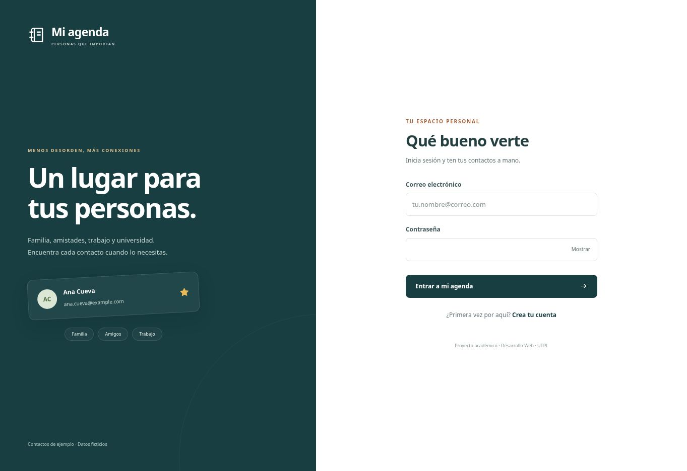
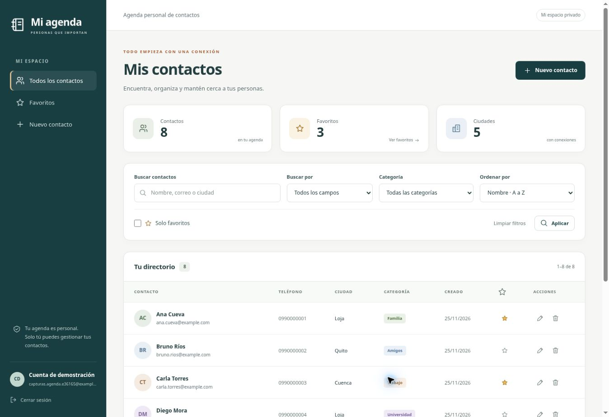
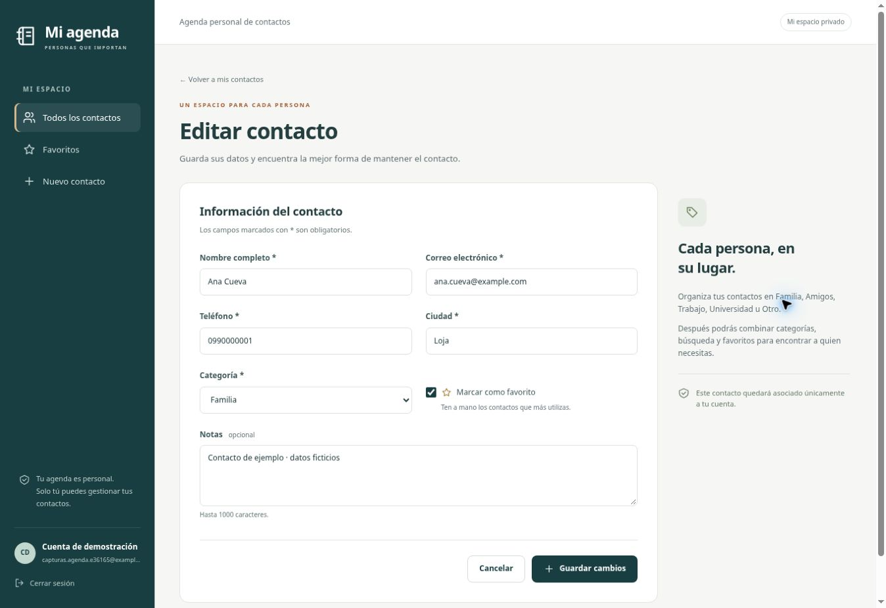
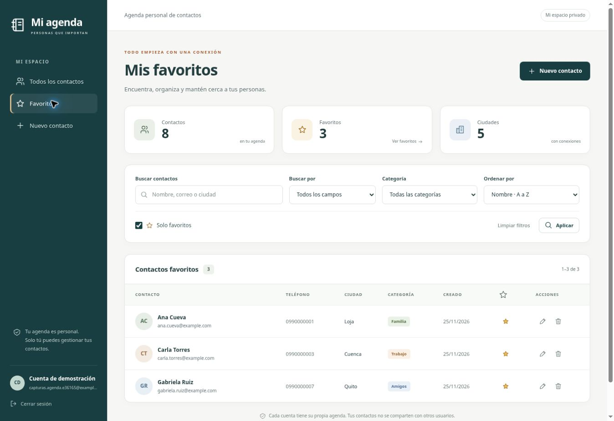
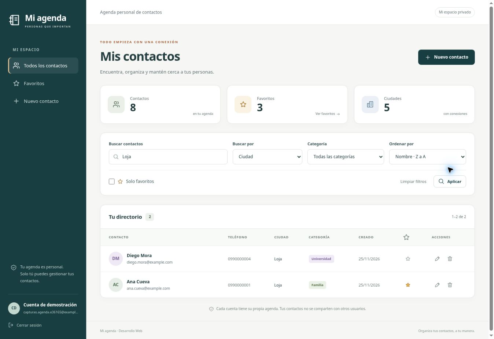

# Mi agenda personal de contactos

Proyecto de **Katherine Ximena Morocho Guanuche**, usuario EVA **kxmorocho**.

Asignatura **Desarrollo Web DSOF_3042** · Docente **Diana Alexandra Torres Guarnizo** · UTPL · Periodo octubre 2026 a febrero 2027.

La aplicación permite registrar una cuenta, iniciar sesión y administrar una agenda privada de contactos. Integra las cuatro mejoras de la actividad APEB1: búsqueda, ordenamiento, categorías y favoritos.

## Estado de los enlaces de entrega

| Entregable | Estado |
| --- | --- |
| URL pública del sistema | [Abrir Mi agenda en Railway](https://agenda-web-production-03f14b30.up.railway.app/) - publicada y comprobada por HTTPS. |
| Repositorio GitHub | [agenda-contactos-katherine](https://github.com/richard149821-hue/agenda-contactos-katherine) - código, SQL y documentación de la actividad. |
| Script SQL actualizado | Disponible en [database/agenda_contactos.sql](database/agenda_contactos.sql). |

El sistema público pasó **50 de 50 comprobaciones HTTP** el 25 de noviembre de 2026 a las 19:16, hora de Ecuador continental. El despliegue de PHP y MySQL está activo en Railway; el código y la documentación se publican en el repositorio enlazado. La disponibilidad del hosting está sujeta a los créditos y límites gratuitos del proveedor.

Para evaluar: abrir la URL, pulsar **Crea tu cuenta**, registrarse con datos de prueba, iniciar sesión y pulsar **Cargar ejemplos**. No hace falta utilizar una cuenta compartida ni acceder al panel del hosting.

## Mejoras de la versión 2

La comparación utiliza los requisitos de la práctica anterior de la agenda con autenticación. No se recibió un repositorio previo de la estudiante; esta entrega reconstruye esa base y añade las mejoras solicitadas.

| Opción | Comportamiento implementado | Cómo comprobarla |
| --- | --- | --- |
| A Búsqueda | Busca por nombre, correo o ciudad, en un campo específico o en los tres a la vez. | Escribir un término, elegir el campo y pulsar Aplicar. |
| B Ordenamiento | Nombre y ciudad en ambos sentidos; fecha de creación de más reciente a más antigua o al revés. | Cambiar Ordenar por y pulsar Aplicar. |
| C Categorías | Tabla `categorias` con Familia, Amigos, Trabajo, Universidad y Otro. Cada contacto tiene una categoría obligatoria. | Crear o editar un contacto y filtrar el directorio por categoría. |
| D Favoritos | Campo `favorito`, edición desde el formulario o la estrella del listado y filtro Solo favoritos. | Activar una estrella y abrir Favoritos. |

Los filtros se pueden combinar y se conservan al cambiar de página. Las búsquedas se ejecutan en el servidor sobre los contactos del usuario autenticado. Los porcentajes y guiones bajos se tratan como texto literal.

Se mantienen el registro, inicio y cierre de sesión, y las operaciones de crear, consultar, editar y eliminar contactos. También se incorporan notas opcionales, paginación de diez contactos, una pantalla de confirmación de borrado y carga opcional de ocho contactos ficticios.

## Capturas de funcionamiento

Las capturas muestran registros ficticios; no contienen información de contactos reales. Las primeras cinco corresponden a la prueba local; la sexta se obtuvo del alojamiento público verificado.

### Inicio de sesión en el hosting público


### Inicio de sesión



### Directorio de contactos



### Formulario de contacto



### Filtro de favoritos



### Búsqueda por ciudad y orden descendente



## Tecnologías y requisitos

- PHP **8.1 o superior**, con extensiones `mysqli`, `mbstring` y `session`.
- MySQL **5.7 o superior**, o MariaDB **10.4 o superior**, con tablas InnoDB y `utf8mb4`.
- HTML5, CSS3 y JavaScript del navegador, sin dependencias externas para la interfaz.
- Apache 2.4 para el hosting, o el servidor de desarrollo de PHP para pruebas locales.
- Git y GitHub para el repositorio. No se necesita Composer ni un framework.

JavaScript solo controla el botón Mostrar u Ocultar contraseña. Las operaciones principales funcionan sin JavaScript. Node.js es opcional: únicamente permite usar el lanzador de vista previa `npm run dev`.

## Instalación local con XAMPP

1. Instalar una versión de XAMPP que incluya PHP 8.1 o superior. Iniciar Apache y MySQL.
2. Copiar esta carpeta en `htdocs/agenda-contactos`.
3. Abrir phpMyAdmin, crear una base llamada `agenda_contactos` con cotejamiento `utf8mb4_unicode_ci` y seleccionarla.
4. Importar **database/agenda_contactos.sql**. El script no crea ni borra bases de datos; trabaja en la base previamente seleccionada.
5. Copiar **config/config.example.php** como **config/config.php** y ajustar los datos de conexión. Para XAMPP local suelen ser servidor `127.0.0.1`, puerto `3306`, usuario `root` y la contraseña configurada en MySQL.
6. Abrir **http://localhost/agenda-contactos/**, crear una cuenta e iniciar sesión.
7. Crear contactos propios o pulsar **Cargar ejemplos** en la agenda vacía.

No se incluye `config/config.php` porque contiene datos propios de cada instalación. Está excluido del control de versiones. Los archivos `.htaccess` deben conservarse.

### Servidor PHP sin XAMPP

Después de crear la base, importar el SQL y configurar la conexión:

```sh
php scripts/diagnostico.php
php -S 127.0.0.1:8080 dev_router.php
```

Abrir **http://127.0.0.1:8080/**. `dev_router.php` protege las carpetas internas cuando se utiliza el servidor local de PHP. Ese servidor es para desarrollo; el hosting utiliza Apache.

### Instalación opcional con Docker

Definir una contraseña local exclusiva para la base de datos y ejecutar:

```sh
export AGENDA_DB_PASSWORD='una-clave-local-que-tu-elijas'
docker compose up --build
```

Abrir **http://localhost:8080/**. Docker crea la base e importa el SQL en el primer inicio del volumen. Los datos quedan en el volumen `agenda_data`. Este camino requiere Docker y Compose; no se utilizó para las pruebas de este paquete.

## Publicación en un hosting gratuito PHP y MySQL

Se incluye una [guía del despliegue realizado en Railway](docs/DESPLIEGUE.md), junto con instrucciones alternativas para InfinityFree. Railway ejecuta PHP 8.3 con Apache y un servicio separado MySQL 8 con volumen persistente. El servicio debe ejecutar PHP y mantener una base MySQL; un hosting que solo publique archivos estáticos no ejecuta esta aplicación.

Para generar un ZIP con los archivos que van dentro de `htdocs`:

```sh
python3 scripts/preparar_hosting.py --salida ../agenda-hosting.zip
```

Ese ZIP incluye las páginas, `app`, `assets`, la configuración de ejemplo y sus protecciones. Excluye credenciales, SQL, pruebas, capturas y documentación. El SQL se importa por separado desde phpMyAdmin.

## Estructura del proyecto

| Ruta | Responsabilidad |
| --- | --- |
| `index.php` | Directorio privado, búsqueda, filtros, ordenamiento y paginación. |
| `registro.php`, `login.php`, `salir.php` | Registro, autenticación y cierre de sesión. |
| `contacto.php` | Alta y edición de contactos del usuario autenticado. |
| `eliminar.php`, `acciones.php` | Confirmación de borrado, acciones POST y cambio de favoritos. |
| `app/` | Sesiones, consultas preparadas, validaciones y componentes de las vistas. |
| `config/` | Configuración de conexión propia de cada instalación. |
| `assets/` | Estilos, JavaScript y favicon. |
| `database/` | Esquema completo y migración opcional de la base anterior. |
| `deploy/`, `health/` | Arranque del contenedor y comprobación pública de disponibilidad. |
| `docs/` | Capturas, explicación de mejoras, publicación y evidencias. |
| `tests/` | Pruebas HTTP de integración. |

## Base de datos y migración

`usuarios.id` se relaciona con `contactos.id_usuario`; `categorias.id` con `contactos.id_categoria`. Ambos vínculos usan claves foráneas. El correo del usuario es único y la contraseña se guarda como hash. La fecha de creación permite ordenar los contactos; su orden se resuelve también por identificador cuando coinciden las fechas.

**Instalación nueva:** importar únicamente `database/agenda_contactos.sql`.

**Base anterior existente:** hacer un respaldo y revisar primero su estructura. `database/migracion_v1_a_v2.sql` agrega las nuevas columnas a la tabla `contactos` de la práctica original y las categorías. Se ejecuta una sola vez, no sobre una instalación nueva de v2. Los contactos anteriores quedan en Otro; su fecha asignada corresponde a la migración, ya que el esquema original no guardaba ese dato. No se conoce la estructura de una instalación previa real de la estudiante, por lo que esa migración debe revisarse antes de aplicarse a una base ajena.

## Seguridad aplicada

- Contraseñas mediante `password_hash()` y verificación mediante `password_verify()`.
- Regeneración de sesión al autenticar y al salir; vencimiento por 30 minutos de inactividad.
- Cookie HttpOnly y SameSite Lax; atributo Secure cuando la solicitud utiliza HTTPS.
- Control de sesión en las páginas privadas y filtro por `id_usuario` en todas las operaciones sobre contactos.
- Consultas preparadas, lista permitida para el ordenamiento y escape de salida con `htmlspecialchars()`.
- Validación en servidor, token CSRF en cada modificación y borrado exclusivamente por POST.
- Pausa temporal de intentos de acceso por sesión y mensajes de error sin detalles de conexión.
- Protección de carpetas internas mediante `.htaccess` y encabezados de seguridad.

La pausa de inicio de sesión es una protección básica por sesión, no un control distribuido contra ataques. Para una aplicación comercial se requerirían controles adicionales. Aquí se utiliza información ficticia para evaluación académica. En Railway se configura `TRUSTED_PROXY=1` para reconocer el HTTPS del proxy y emitir cookies Secure; esa opción se activa únicamente detrás de un proxy de confianza.

## Pruebas reproducibles

Con la aplicación y MySQL funcionando, instalar las dependencias de las pruebas, independientes del sistema web:

```sh
python3 -m pip install requests beautifulsoup4
python3 tests/integration.py --base-url http://127.0.0.1:8080/ --output pruebas.json
```

Para repetir la verificación del alojamiento, sustituir la dirección local por `https://agenda-web-production-03f14b30.up.railway.app/`. En HTTPS se comprueba también el atributo Secure de la cookie.

La prueba crea dos cuentas nuevas con correos ficticios únicos y verifica registro, autenticación, CRUD, las cuatro mejoras, paginación, validaciones, separación entre usuarios, CSRF, escape HTML y archivos privados. No utiliza cuentas reales ni borra registros de otros usuarios. Las cuentas de prueba quedan en la base para poder inspeccionarlas.

Las evidencias y el entorno realmente comprobado están en [docs/PRUEBAS.md](docs/PRUEBAS.md).

## Eventos de usuario y ejecución por consola

En la interfaz web, enviar un formulario, aplicar un filtro o pulsar una estrella son eventos del usuario que originan solicitudes HTTP. PHP procesa cada solicitud de forma secuencial, valida la sesión, consulta MySQL y devuelve una página. El pequeño script del navegador responde al clic de Mostrar contraseña. Un programa de consola, como `scripts/diagnostico.php`, recibe sus entradas al ejecutarse y muestra el resultado en la terminal; no espera interacciones con botones o formularios HTML.

## Referencias de la asignatura

- Diana Alexandra Torres Guarnizo, [ejemplosdesarrollo](https://github.com/dianatorresguarnizo/ejemplosdesarrollo), especialmente `iniciando-php` y `gestion-usuarios-seguro`.
- Diana Alexandra Torres Guarnizo, [webdesarrollo](https://github.com/dianatorresguarnizo/webdesarrollo), prácticas PHP y MySQL.
- Plan docente y guía didáctica de Desarrollo Web DSOF_3042, periodo octubre 2026 a febrero 2027.
- Grabación compartida cuyo archivo empieza por `GMT20261118-000059`, donde se presenta esta actividad.

Los ejemplos de clase se utilizaron como referencia conceptual. El código de esta agenda implementa los requisitos del trabajo y no se presenta como una copia de un repositorio previo de la estudiante.
